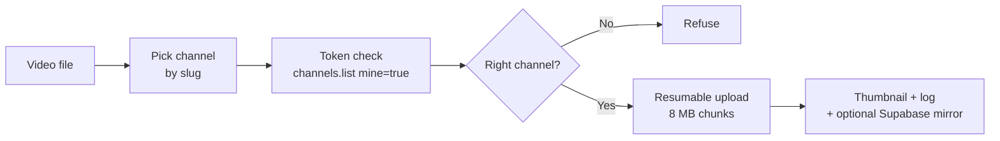

<p align="center">
  <a href="https://superuploadermcp.nemonit.com/"></a>
  <a href="https://github.com/smabdulmueid97/YouTube-SuperUploaderMCP/blob/main/LICENSE"></a>
  <a href="https://github.com/smabdulmueid97/YouTube-SuperUploaderMCP"></a>
  <a href="https://github.com/smabdulmueid97/YouTube-SuperUploaderMCP"></a>
</p>

<h1 align="center">YouTube-SuperUploaderMCP</h1>

<p align="center">
  One command uploads a video to any of your YouTube channels — Shorts or
  long-form, with titles, descriptions, tags, thumbnails, scheduled
  publishing, batch uploads, and first comments.<br />
  No fresh Google login per upload. No video goes out without approval.
</p>

> **For Claude / any AI agent:** this README *is* the installation guide.
> Follow the steps in order, top to bottom. Do not skip the safety rules
> in [Safety](#%EF%B8%8F-safety-rules). If a step fails, check
> [Troubleshooting](#-troubleshooting) before trying another route.

---

## What this is

A small Python tool that uploads videos to many YouTube channels from one
machine, using one OAuth token per channel. It is built for daily uploads
across a fleet of channels owned by one person: one Google login, one token
per channel, and a safety check that proves the token belongs to the
intended channel before anything uploads.



## What you need

- **Python 3.11+** and **ffmpeg + ffprobe** (`ffmpeg` on PATH; ffprobe is
  used to detect Shorts and read video duration).
- **A Google account** that manages the YouTube channels (they can be
  Brand Accounts — see the note in Step 1).
- **A Google Cloud project** you control (free; no billing needed for the
  YouTube Data API).
- Optional: a **Supabase** project (for the upload log mirror, see
  `supabase.md`) and a **Cloudflare** account (to host the home page +
  privacy policy the OAuth app needs, see `website/DEPLOY.md`).

## Step 1 — Google Cloud project and OAuth client

1. In [Google Cloud Console](https://console.cloud.google.com/), create a
   project (any name, e.g. `My YouTube Uploader`).
2. Enable **YouTube Data API v3** and **YouTube Analytics API**
   (APIs & Services → Library).
3. Open **Google Auth Platform → Branding**: set the app name, user support
   email, and developer contact email. User type: **External**.
4. Open **Google Auth Platform → Data Access** and add **all 9 YouTube
   scopes** (adding them all now avoids another re-authorization round
   later):
   - `https://www.googleapis.com/auth/youtube.upload`
   - `https://www.googleapis.com/auth/youtube`
   - `https://www.googleapis.com/auth/youtube.readonly`
   - `https://www.googleapis.com/auth/youtube.force-ssl`
   - `https://www.googleapis.com/auth/youtube.channel-memberships.creator`
   - `https://www.googleapis.com/auth/yt-analytics.readonly`
   - `https://www.googleapis.com/auth/yt-analytics-monetary.readonly`
   - `https://www.googleapis.com/auth/youtubepartner`
   - `https://www.googleapis.com/auth/youtubepartner-channel-audit`
   
   The two `youtubepartner` scopes only work for YouTube CMS content
   partners and are unusable for a regular account, but they are part of
   the full set. All except `yt-analytics.readonly` show as sensitive;
   that is normal.
5. While the app is in Testing, add your own Google account under
   **Google Auth Platform → Audience → Test users**.
6. Create the OAuth client: **Clients → Create Client → Desktop app**.
   Download the JSON and save it as `client_secret.json` next to
   `uploader.py`. Set `chmod 600 client_secret.json`. **Never commit it,
   never print it, never paste it into chat.**

> **Why one token per channel.** `videos.insert` has no `channelId`
> parameter — it uploads to whichever channel the token belongs to, and
> `channels.list(mine=true)` returns only that one channel. There is no
> single token that can upload to many channels. The only exception,
> `onBehalfOfContentOwner`, is for YouTube CMS content partners only.
> Brand Account **Manager/Owner** roles do appear in the OAuth channel
> chooser and work via the API; YouTube Studio **Settings → Permissions**
> roles do not. So: one Google login, one OAuth flow per channel, one
> refresh token per channel.

## Step 2 — Publish the OAuth app (do this before daily use)

While the app is in **Testing**, Google expires refresh tokens after
**7 days**. Publish it to stop that:

1. The Branding page needs a real **home page URL** and **privacy policy
   URL**. Deploy `website/index.html` + `website/privacy.html` somewhere
   public — Cloudflare Pages works (see `website/DEPLOY.md`); any static
   host works. No owned domain is needed; a `*.pages.dev` URL is enough.
2. Put those two URLs in Branding, add your domain to **Authorized
   domains**, and on the **Audience** page click **Publish app**.
   Status becomes **In production**.
3. Google shows a "requires verification" banner. You do **not** need to
   submit for verification while only you use the app (unverified apps
   have a 100-user cap, which does not matter for owner-only use).

## Step 3 — Install the tool

```bash
git clone https://github.com/smabdulmueid97/YouTube-SuperUploaderMCP.git
cd YouTube-SuperUploaderMCP
python3 -m venv venv
venv/bin/pip install -r requirements.txt
```

Set the timezone used for `--publish-at` (default is Asia/Dhaka):

```bash
export UPLOADER_TIMEZONE="Asia/Dhaka"   # or your own, e.g. America/New_York
```

## Step 4 — Describe your channels

```bash
cp channels.example.json channels.json
```

Fill in `channels.json` with your own channels. Each entry needs a
`slug` (the short name you will type on the command line), the channel's
display `name`, its `handle`, and its `channel_id`. Find a channel ID in
YouTube Studio → Settings → Channel → Advanced settings. `channels.json`
is git-ignored: it holds your channel list and never goes into the repo.

## Step 5 — Authorize each channel (one OAuth flow per channel)

```bash
venv/bin/python auth_channel.py --channel my-channel
```

The script starts a local OAuth server and prints a Google authorization
URL. Then:

1. Open that exact URL in a browser. Sign in with the Google account
   from Step 1 if asked.
2. In the channel chooser, pick **exactly** the channel matching the slug.
   That choice decides which channel the token belongs to.
3. If Google shows "Google hasn't verified this app", click **Advanced →
   Go** (expected for an unverified app you own).
4. Approve all scopes.
5. Google redirects to `http://localhost:<port>/...`. In a cloud/remote
   browser that page fails to load (`ERR_CONNECTION_REFUSED`) — that is
   expected. Copy the **full redirect URL from the address bar** (it
   contains a one-time code) and deliver it to the waiting server, e.g.
   `curl "http://localhost:<port>/?code=...&scope=..."` from the machine
   running the script. The flow exchanges the code and saves the token to
   `tokens/<slug>.json` (mode 600).
6. Repeat for every channel. A one-time code is spent after one use —
   never reuse it.

## Step 6 — Verify the tokens

```bash
venv/bin/python verify_channels.py          # all channels
venv/bin/python verify_channels.py --channel my-channel
```

Each token is checked live (`channels.list(mine=true)`) against
`channels.json`. Exit code is 0 only when every checked token matches its
expected channel. A mismatch is reported, never silently accepted.

## Step 7 — Upload your first video (dry-run first)

Always dry-run first. A dry-run validates everything and prints the exact
request, but uploads **nothing**.

```bash
# Shorts, scheduled (time is $UPLOADER_TIMEZONE)
venv/bin/python upload.py --channel my-channel \
  --video my-short.mp4 --title "My title" \
  --description "Description" --tags funny,shorts \
  --thumbnail thumb.jpg --publish-at "2026-12-01 18:00" --dry-run

# Long-form, private for now
venv/bin/python upload.py --channel my-channel \
  --video my-video.mp4 --title "My title" --dry-run
```

Remove `--dry-run` ONLY for a video the owner has approved. Other
options: `--privacy unlisted|public`, `--shorts` (force Shorts marking;
normally auto-detected: square or vertical, 3 minutes or less), `--force`
(re-upload a file that was already uploaded).

On success the CLI prints `UPLOADED: <url>` and the `video_id`.

### Dashboard

```bash
venv/bin/python status.py            # table from logs + registry
venv/bin/python status.py --verify   # also checks all tokens live
```

`dashboard.html` is regenerated each time — open it in a browser. It
never contains tokens.

## Step 8 — Batch uploads, A/B variants, publishing, comments

**Batch upload** (`run_batch.py`) uploads several videos to several
channels from one manifest, with a different title/thumbnail variant per
channel (pseudo-A/B: YouTube's native Test & Compare has no public API
and does not work for Shorts). Copy `batch.example.json` to `batch.json`
and fill it in: `channels` in order, `variant_map` (which variant each
channel gets), and one entry per video with `file`, `description`,
`tags`, `comment`, and `variants` (each with `title` + `thumbnail`).

```bash
# Pilot first: first video -> first channel, variant 0. Prove the pipeline.
venv/bin/python run_batch.py --manifest batch.json --results results.json --stage pilot
# Then everything else:
venv/bin/python run_batch.py --manifest batch.json --results results.json --stage rest
# Or all in one go:
venv/bin/python run_batch.py --manifest batch.json --results results.json --stage all
```

**Publish** (`publish_all.py`) flips every video in a results file to
public (or unlisted). It reads each video's current status first and
changes only `privacyStatus`, then verifies the new value.

```bash
venv/bin/python publish_all.py --results results.json --privacy public
```

**Comments.** Post a first comment on one video:

```bash
venv/bin/python comment.py --channel my-channel --video-id <id> --text "..."
```

Or on every video in a results file, using the manifest's comment text:

```bash
venv/bin/python comment_all.py --batch batch.json --results results.json
```

## Step 9 — Measuring what worked (no external tools)

The tokens carry the YouTube Analytics API scopes, so success can be
measured directly from YouTube: per video — views, watch time, average
view duration, likes, comments, shares, subscribers gained, impressions,
click-through rate; per channel — traffic sources, search terms,
audience age/location/devices; money — estimated revenue and CPM.
Analytics queries cost ~1 quota unit each. Two caveats: analytics lag
~1–2 days, and cross-channel A/B comparisons are confounded by different
audiences — click-through rate is the fairest comparison between
variants.

## 🧭 How it works

- **Token per channel:** the token decides the destination. Before every
  upload the engine checks `channels.list(mine=true)` and refuses if the
  token's channel ID does not match `channels.json`.
- **Auto-refresh:** expired access tokens refresh from the stored refresh
  token and are saved back to the same token file.
- **Resumable upload:** 8 MB chunks over `requests` (proxy-aware).
  `google-api-python-client` / httplib2 is not used for the upload — it
  fails behind some proxies with SSL `WRONG_VERSION_NUMBER`. A broken
  connection resumes from the server-reported offset; a retry never
  creates a second video.
- **Scheduling:** `--publish-at "YYYY-MM-DD HH:MM"` is
  `$UPLOADER_TIMEZONE`, converted to UTC. Scheduled videos are `private`
  + `publishAt`.
- **Duplicates:** SHA-256 of each uploaded file is stored in
  `uploads/registry.json`. Re-uploading the same file to the same channel
  is refused unless `--force` is given. The registry record is saved
  before the thumbnail step, so a retry can never duplicate an upload.
- **Thumbnails:** `thumbnails.set` posts raw image bytes to the
  `/upload/` endpoint (the plain endpoint and multipart both return 400
  `mediaBodyRequired`).
- **Logs:** every event (started, succeeded, failed, thumbnail set,
  dry-run, token refreshed) is appended to `logs/<slug>.jsonl` and,
  if configured, mirrored to Supabase (`yt_upload_logs` / `yt_uploads`).

## 🗂️ Files

- `uploader.py` — the engine (tokens, refresh, resumable upload,
  thumbnails, scheduling, privacy changes, logs, duplicates, retry)
- `upload.py` — command line for one upload
- `run_batch.py` — batch uploads with A/B variants from a manifest
- `publish_all.py` — flip a results file's videos to public/unlisted
- `comment.py` — post a first comment on one video
- `comment_all.py` — post first comments for a whole results file
- `status.py` — dashboard (terminal table + `dashboard.html`)
- `verify_channels.py` — verify tokens (read-only)
- `auth_channel.py` — run one OAuth flow for a channel (only if a token
  expires/breaks)
- `supabase_backend.py` — mirrors logs + registry to Supabase (optional)
- `supabase.md` — Supabase mirror setup (optional)
- `channels.json` — your channel list (git-ignored; copy from
  `channels.example.json`)
- `channels.example.json` — template for `channels.json`
- `batch.example.json` — template for a batch manifest
- `tokens/` — one OAuth token per channel (mode 600, never committed,
  never printed)
- `uploads/registry.json` — every completed/scheduled upload (duplicate
  prevention)
- `logs/<slug>.jsonl` — per-channel event log
- `website/` — home page + privacy policy for the OAuth app
  (deploy with `deploy_pages.py`, see `website/DEPLOY.md`)
- `requirements.txt` — Python dependencies

## 🛡️ Safety rules

- **Never publish a video without the owner's approval for that video.**
  Default privacy is `private`; say `--privacy public` only when the
  owner said so.
- **SAFE TEST MODE (optional):** create an empty file named `SAFE_MODE`
  next to `uploader.py` and real uploads are blocked while it exists.
  Dry-runs still work. Delete it only after the owner approves real
  uploads.
- **Never copy tokens out of `tokens/`**, never print them, never put
  them in logs, docs, or chat. `client_secret.json` and `tokens/` are
  git-ignored for a reason.
- **Never change channel permissions from these scripts.**
- **Never share `client_secret.json` or a token file** with anyone,
  including another AI session, unless the owner explicitly asks.

## 📊 Quota & limits

- **Uploads:** `videos.insert` costs 1 unit in its own Video Uploads
  bucket — **100 uploads/day per project by default**. No quota increase
  needed for daily multi-channel uploads. (Dec 4, 2025 the cost fell
  from ~1,600 units to ~100; Jun 1, 2026 uploads moved into their own
  bucket.)
  Source: `developers.google.com/youtube/v3/docs/videos/insert`.
- **Other calls** share the 10,000 units/day pool: `thumbnails.set` 50,
  `commentThreads.insert` 50, `videos.update` 50, reads ~1.
- **Privacy default changed:** the same official page says an upload
  with no `privacyStatus` now defaults to **public**, and videos from
  unverified API projects are **not** restricted to private anymore.
  This engine always sends an explicit `privacyStatus` (default
  `private`) and never relies on the API default.
- **Shorts:** a Short is a **square or vertical** video of **3 minutes
  or less** (rule since 15 Oct 2024). The engine detects this with
  ffprobe. Caution: a Short over 1 minute with an active Content ID
  claim can be blocked globally, so clear the audio before posting
  longer Shorts.
- **Length:** verified channels can upload up to **12 hours or 256 GB**,
  whichever is less. Unverified channels are capped at **15 minutes**.
  Source: YouTube Help, "Upload videos longer than 15 minutes".
- **Thumbnails:** a channel needs phone verification in YouTube Studio
  before custom thumbnails work; otherwise `thumbnails.set` returns 403.
- **Comments:** YouTube refuses comments on **private** videos —
  publish (public/unlisted) first. Pinning a comment is not possible
  via the API (Studio only).
- **A/B testing:** native Test & Compare is Studio-only with no public
  API and does not work for Shorts. This tool prepares variants and
  spreads them across channels as a proxy.

## 🌐 Website & OAuth publishing

The home page + privacy policy live in `website/` and are deployed on
Cloudflare Pages (see `website/DEPLOY.md`). Those two public URLs are
what Google's Branding page requires before the OAuth app can be
Published — and publishing is what stops refresh tokens expiring after
7 days.

## 🔧 Troubleshooting

- **"Google hasn't verified this app"** — expected for an unverified app
  you own. Click **Advanced → Go** (or "Continue") to proceed.
- **Localhost redirect fails to load in the browser** — expected in a
  cloud/remote browser. Copy the full redirect URL from the address bar
  and `curl` it to the waiting local server (Step 5, step 5).
- **Refresh token expired after 7 days** — the OAuth app is still in
  Testing. Publish it (Step 2).
- **`thumbnails.set` 403 "doesn't have permissions"** — the channel
  needs phone verification in YouTube Studio first.
- **Comments 403 "forbidden"** — check the video is public/unlisted
  (comments are refused on private videos) and the token carries the
  `youtube.force-ssl` scope.
- **SSL `WRONG_VERSION_NUMBER`** — the engine already avoids
  `google-api-python-client`/httplib2 for uploads and uses `requests`
  instead. If you see this from a new call path, route it through the
  engine's `_request_with_retry`.
- **A retry uploaded a second copy?** — the registry record is saved
  before the thumbnail step, so a retry reuses the registered video
  instead of uploading again. Check `uploads/registry.json`.
- **"Token mismatch" from `verify_channels.py`** — the wrong channel was
  picked in the OAuth chooser. Re-run `auth_channel.py` for that slug
  and pick the right channel.
