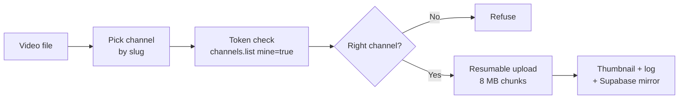

<p align="center">
  <a href="https://superuploadermcp.nemonit.com/"></a>
  <a href="https://github.com/smabdulmueid97/YouTube-SuperUploaderMCP/blob/main/LICENSE"></a>
  <a href="https://github.com/smabdulmueid97/YouTube-SuperUploaderMCP"></a>
  <a href="https://github.com/smabdulmueid97/YouTube-SuperUploaderMCP"></a>
  <a href="https://github.com/smabdulmueid97/YouTube-SuperUploaderMCP"></a>
</p>

<h1 align="center">YouTube-SuperUploaderMCP</h1>

<p align="center">
  One command uploads a video to any of <b>9 YouTube channels</b> — Shorts or long-form,<br />
  with titles, descriptions, tags, thumbnails, and scheduled publishing.<br />
  No fresh Google login per upload. No video goes out without approval.
</p>

<p align="center">
  🔗 <b><a href="https://superuploadermcp.nemonit.com/">Live: https://superuploadermcp.nemonit.com/</a></b>
</p>

<p align="center">
  <a href="#-how-it-works">How it works</a> •
  <a href="#-quick-start">Quick start</a> •
  <a href="#-channels">Channels</a> •
  <a href="#-safety-rules">Safety</a> •
  <a href="#-quota--shorts">Quota & Shorts</a>
</p>

---

## Why this exists

Nine channels, one owner, daily uploads. Logging into Google in a browser
for every upload does not scale — and a wrong click can post a video to the
wrong channel. This tool fixes both: one OAuth token per channel, picked by
slug, and a safety check that proves the token belongs to the intended
channel before anything uploads.



## 🧭 How it works

- **Token per channel:** `videos.insert` has no channelId parameter — the
  token decides the destination. Before every upload the engine checks
  `channels.list(mine=true)` and refuses if the token's channel ID does not
  match `channels.json`.
- **Auto-refresh:** expired access tokens refresh from the stored refresh
  token and are saved back to the same token file.
- **Resumable upload:** 8 MB chunks over `requests` (proxy-aware).
  `google-api-python-client` / httplib2 is not used — it fails here with
  SSL `WRONG_VERSION_NUMBER`. A broken connection resumes from the
  server-reported offset; a retry never creates a second video.
- **Scheduling:** `--publish-at "YYYY-MM-DD HH:MM"` is Asia/Dhaka,
  converted to UTC. Scheduled videos are `private` + `publishAt`.
- **Duplicates:** SHA-256 of each uploaded file is stored in
  `uploads/registry.json`. Re-uploading the same file to the same channel
  is refused unless `--force` is given.
- **Logs:** every event (started, succeeded, failed, thumbnail set,
  dry-run, token refreshed) is appended to `logs/<slug>.jsonl` and
  mirrored to Supabase (`yt_upload_logs` / `yt_uploads`).

## 🚀 Quick start

Always dry-run first. A dry-run validates everything and shows the exact
request, but uploads **nothing**.

```bash
# Shorts, scheduled (time is Asia/Dhaka)
venv/bin/python upload.py --channel nemonit \
  --video my-short.mp4 --title "My title" \
  --description "Description" --tags funny,shorts \
  --thumbnail thumb.jpg --publish-at "2026-11-28 18:00" --dry-run

# Long-form, publish now as private
venv/bin/python upload.py --channel bangla-cartoons-folklore \
  --video my-video.mp4 --title "My title" --dry-run
```

Remove `--dry-run` ONLY for a video the owner has approved.

Other options: `--privacy unlisted|public`, `--shorts` (force Shorts
marking; normally auto-detected: square or vertical, 3 minutes or less),
`--force` (re-upload a file that was already uploaded).

### Dashboard

```bash
venv/bin/python status.py            # table from logs + registry
venv/bin/python status.py --verify   # also checks all 9 tokens live
```

`dashboard.html` is regenerated each time — open it in a browser.
It never contains tokens.

## 📺 Channels

All 9 verified 2026-11-27 (9/9, re-checked live after the OAuth app was
Published). Manager account: smabdulmueid03@gmail.com (one Google login,
9 tokens).

| Channel | Slug | Channel ID |
|---|---|---|
| Bangla Cartoons & Folklore | bangla-cartoons-folklore | UC1TQjE1na7-9s-fkMbfqeoA |
| Cooking Video Animated | cooking-video-animated | UCKW1ayhenW3-l2bE2zmm_fw |
| Nemonit | nemonit | UC6lfzQiwEy81TZQfgAPKvAg |
| Nemonit Discovery | nemonit-discovery | UCLfR9QVwKC8XF9nbn5-csPw |
| Nemonit Games Memes | nemonit-games-memes | UCk2oqwtm5mMdoYn9BF_YGSQ |
| Nemonit Music OST | nemonit-music-ost | UC4dHQH5sx_qYmWF1v7q1Kpw |
| Nemonit Nature 8k | nemonit-nature-8k | UC7Us2J3u-tVfMJk_COjPBTQ |
| S M Abdul Mueid | s-m-abdul-mueid | UCc7ftQo8JOgy03PZmGKVTcA |
| The AI Whisper | the-ai-whisper | UCQvOQvNTj1t4GFro_EHAj6A |

## 🗂️ Files

- `uploader.py` — the engine (tokens, refresh, resumable upload, thumbnails, scheduling, logs, duplicates, retry)
- `upload.py` — command line for one upload
- `status.py` — dashboard (terminal table + `dashboard.html`)
- `verify_channels.py` — verify all 9 tokens (read-only)
- `auth_channel.py` — run one OAuth flow for a channel (only if a token expires/breaks)
- `supabase_backend.py` — mirrors logs + registry to Supabase via Composio
- `channels.json` — verified channel list (source of truth for IDs)
- `tokens/` — one OAuth token per channel (mode 600, never committed, never printed)
- `uploads/registry.json` — every completed/scheduled upload (duplicate prevention)
- `logs/<slug>.jsonl` — per-channel event log
- `website/` — home page + privacy policy, deployed on Cloudflare Pages
- `test/` — test videos + thumbnail used for dry-run testing (generated locally with ffmpeg, not committed)

## 🛡️ Safety rules

- **SAFE TEST MODE is ON.** Real uploads are blocked while the
  `SAFE_MODE` file exists next to `uploader.py`. Dry-runs still work.
  Delete that file ONLY after the owner approves real uploads.
- Never publish a video without the owner's approval for that video.
- Never copy tokens out of `tokens/`, never print them, never put
  them in logs, docs, or chat.
- Never change channel permissions from these scripts.

## 📊 Quota & Shorts

- **Uploads:** `videos.insert` costs 1 unit in its own Video Uploads
  bucket — **100 uploads/day per project by default**. 9 uploads/day
  fits easily; no quota increase needed. (Dec 4, 2025 the cost fell
  from ~1,600 units to ~100; Jun 1, 2026 uploads moved into their
  own bucket.)
  Source: `developers.google.com/youtube/v3/docs/videos/insert`.
- **Other calls** (reads, thumbnails, etc.) still share the 10,000
  units/day pool. `thumbnails.set` costs 50 units.
- **Privacy default changed:** the same official page says an upload
  with no `privacyStatus` now defaults to **public**, and videos from
  unverified API projects are **not** restricted to private anymore.
  This engine always sends an explicit `privacyStatus` (default
  `private`) and never relies on the API default.
- **Shorts:** a Short is a **square or vertical** video of **3 minutes
  or less** (rule since 15 Oct 2024). The engine detects this with
  ffprobe. Caution: a Short over 1 minute with an active Content ID
  claim can be blocked globally, so clear the audio before posting
  longer Shorts.

## 🌐 Website & OAuth publishing

The home page + privacy policy live on Cloudflare Pages at
https://superuploadermcp.nemonit.com/ (also at
https://youtube-superuploadermcp.nemonit.com/ and
https://nevo-youtube-uploader.pages.dev/). The Google OAuth app
"Nevo YouTube Uploader" (project `nevo-youtube-uploader`) is
**Published — In production** since 2026-11-27, so refresh tokens no
longer expire after 7 days. Google shows a "requires verification"
banner; the app has not been submitted for verification, which is
fine while only the owner uses it.
